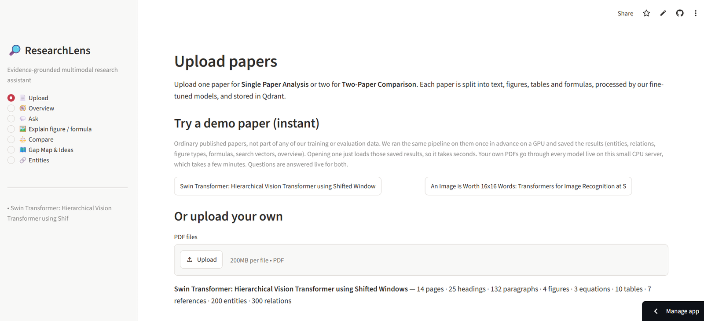
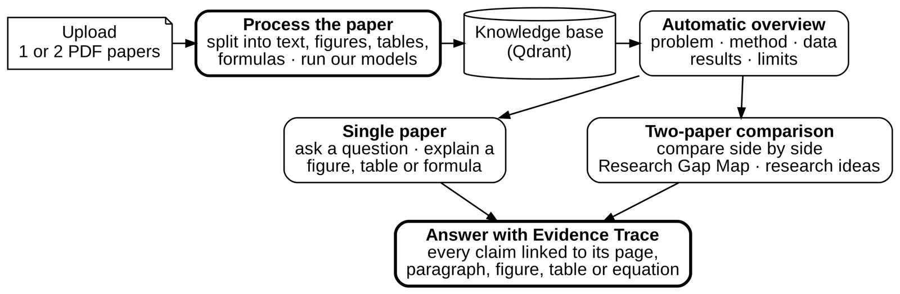
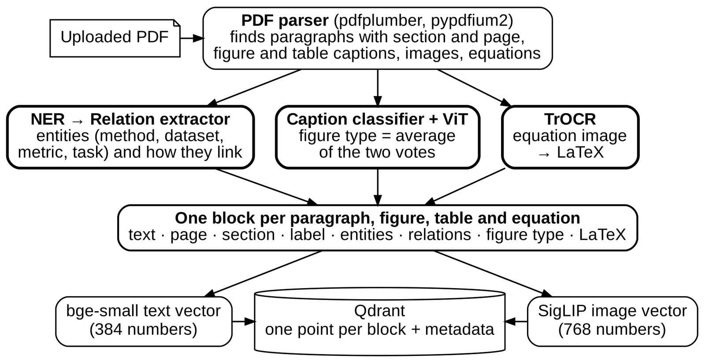
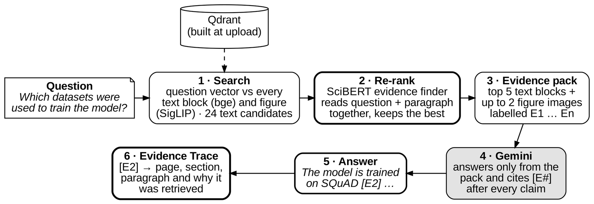
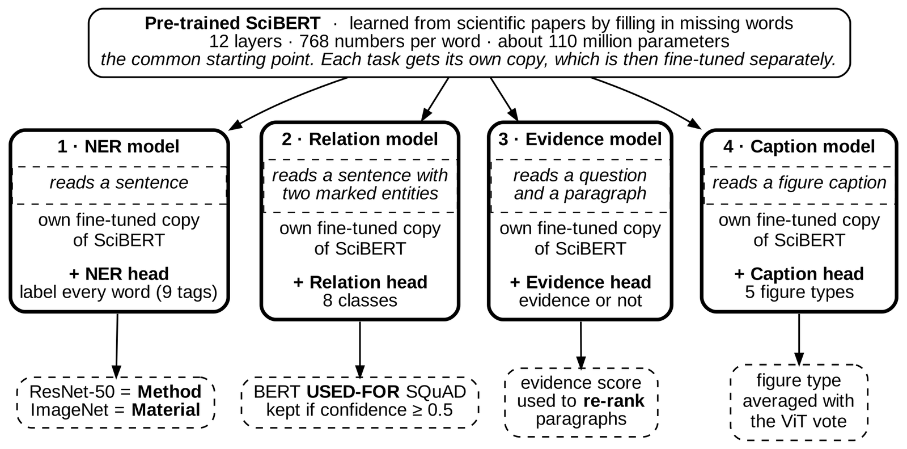
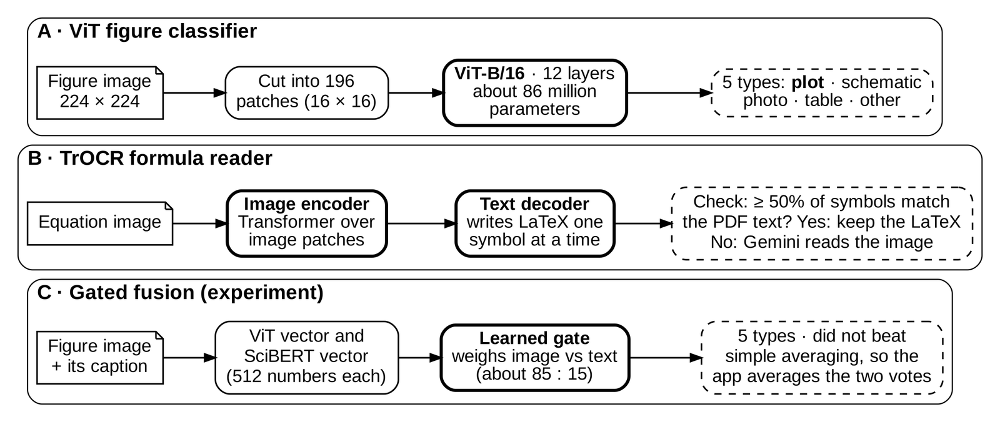
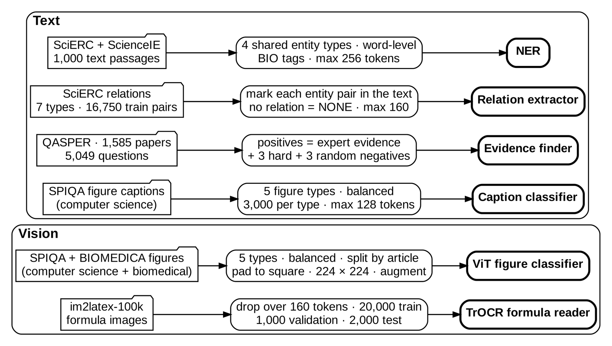
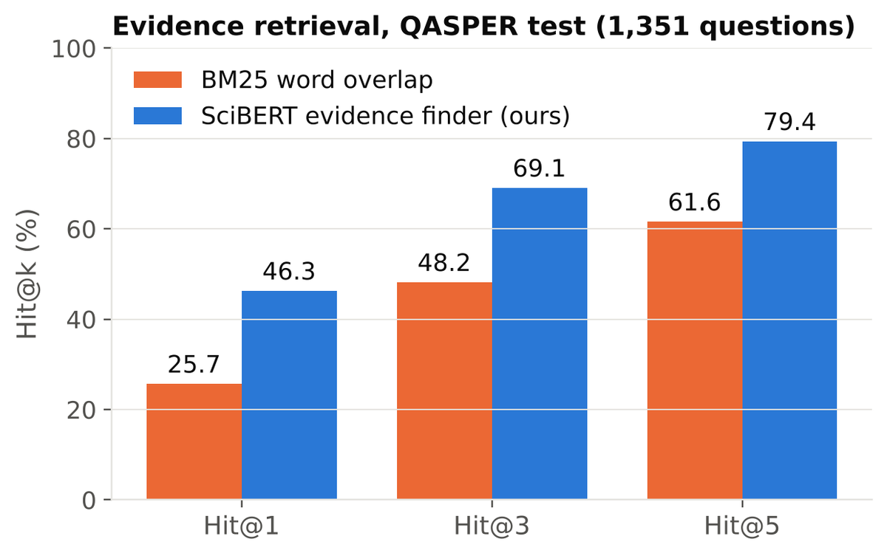
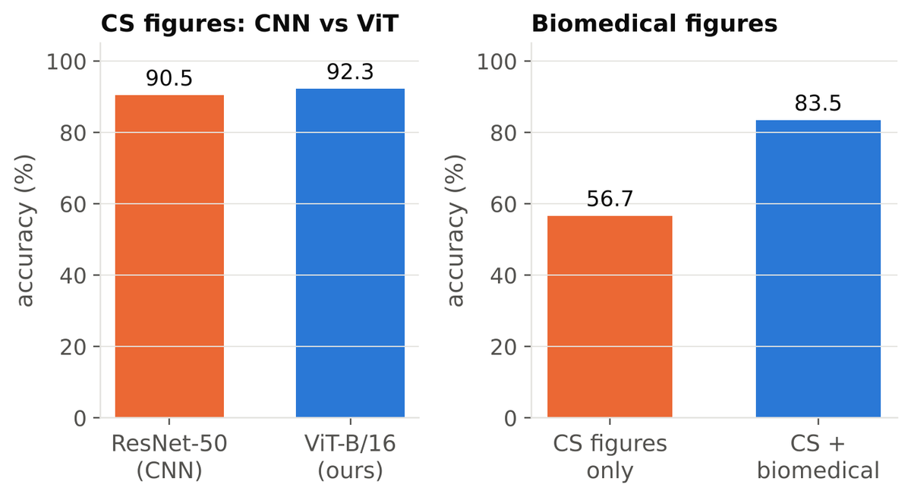

<div align="center">

# 🔎 ResearchLens

**An evidence-grounded multimodal assistant for reading, comparing and questioning scientific papers**

[](https://researchlenzz.streamlit.app)


MSc Applied AI · University of Wollongong in Dubai<br>
MAAI901 (DB426) Deep Learning for Visual Data · MAAI902 (DB426) Natural Language Processing & LLMs

[Live demo](https://researchlenzz.streamlit.app) · [Report](docs/report/) · [Slides](docs/presentation/) · [Results](results/README.md) · [Notebooks](notebooks/README.md)

</div>

---

## Overview

Scientific papers keep much of their evidence in figures, tables and equations, and a plain chatbot cannot point to
where an answer came from. ResearchLens reads the **text, figures, tables and formulas** of one or two uploaded PDFs,
answers questions with an **Evidence Trace** (page, section, paragraph, figure or equation), compares two papers,
and maps research gaps with possible research directions.

It is built from **seven fine-tuned models** (four SciBERT, ViT-B/16, TrOCR and a gated fusion experiment),
pre-trained search encoders (bge-small for text, SigLIP for images), a **Qdrant** knowledge base and **Gemini** for
the final multimodal answer.

<p align="center">
  
</p>

### Features

| Mode | What you get |
|---|---|
| **Single paper** | Automatic overview (problem, method, data, results, limitations), questions answered with citations, figure, table and formula explanations, entity and relation browser |
| **Two papers** | Side-by-side comparison, **Research Gap Map** and **research ideas**, each linked back to evidence in both papers |
| **Evidence Trace** | Every claim carries an `[E#]` label that resolves to the page, section and paragraph, figure, table or equation it came from |

## How it works

The project has three parts: **(1)** fine-tune the models on public datasets, **(2)** turn each uploaded PDF into a
searchable knowledge base, **(3)** answer questions from that knowledge base in a Streamlit app.

<p align="center"></p>

**At upload (once per paper).** pdfplumber reads every word with its position and font, and pypdfium2 renders figures
and tables at 2.5× scale. Our models enrich each block: entities and relations from the text, the figure type
(average of the ViT and caption-classifier votes), and LaTeX from TrOCR. Each paragraph, figure, table and equation
becomes one Qdrant point with a bge text vector, a SigLIP image vector for figures, and its page and section.

<p align="center"></p>

**At question time.** There is no intent classifier: the question itself retrieves whatever is relevant. Text blocks
are found with bge and re-ranked by our SciBERT evidence finder; figures are found with SigLIP image search. The top
5 text blocks and up to 2 figure images form the evidence pack, and Gemini (temperature 0) answers only from that pack,
citing `[E#]` after every claim.

<p align="center"></p>

## Models

All models are fully fine-tuned (only the SciBERT word embeddings are frozen), with AdamW, mixed precision, seed 42,
early stopping on the validation score and the best checkpoint kept. Settings: [`configs/`](configs/) and
[`docs/HYPERPARAMETERS.md`](docs/HYPERPARAMETERS.md).

| Side | Model | Base | Task | Dataset | Hugging Face repo |
|---|---|---|---|---|---|
| NLP | NER | SciBERT | label methods, datasets, tasks, metrics | SciERC + ScienceIE | `researchlens-scibert-ner-multidomain` |
| NLP | Relation extractor | SciBERT | how two marked entities relate (8 classes) | SciERC | `researchlens-scibert-relation` |
| NLP | Evidence finder | SciBERT | does this paragraph answer the question? (re-ranker) | QASPER | `researchlens-scibert-evidence` |
| NLP | Caption classifier | SciBERT | figure type from the caption | SPIQA captions | `researchlens-scibert-caption-figure-type` |
| Vision | Figure classifier | ViT-B/16 (ImageNet-21k) | figure type from the image (5 classes) | SPIQA + BIOMEDICA | `researchlens-vit-figure-type-multidomain` |
| Vision | Formula reader | TrOCR-small | equation image → LaTeX | im2latex-100k | `researchlens-trocr-formula` |
| Vision | Gated fusion (experiment) | ViT + SciBERT | figure type from image + caption | SPIQA | `researchlens-fusion-figure-type` |
| Pre-trained | Text / image search | bge-small-en-v1.5 / SigLIP | embeddings for retrieval (not fine-tuned) | | |
| Pre-trained | Answer generator | Gemini (Google AI Studio API) | multimodal answer from the evidence pack (not fine-tuned) | | |

Fine-tuned models are stored under the `Kavinvelavan` account on Hugging Face and loaded by the app with `HF_TOKEN`.

<details>
<summary><b>Model diagrams</b></summary>
<p align="center"></p>
<p align="center"></p>
<p align="center"></p>
</details>

## Key results

Held-out test sets; full tables and graphs in [`results/README.md`](results/README.md).

| Result | Score |
|---|---|
| Evidence finder Hit@1 on 1,351 QASPER questions | **46.3%** vs 25.7% for BM25 |
| ViT figure accuracy, CS / biomedical | **91.6% / 83.5%** (biomedical was 56.7% with CS-only training) |
| ViT vs ResNet-50 on CS figures | **92.3%** vs 90.5% |
| TrOCR formula reader | **85.2** BLEU-4, 12.9% character error rate |
| NER entity F1, AI papers / other fields | **61.0 / 39.3** |
| Relation extractor micro-F1 · caption classifier accuracy | **67.7 · 80.3%** |
| Answer F1 on 100 QASPER questions | **42.2** with our pipeline vs 8.2 for Gemini alone |
| Figure questions answered correctly (50 SPIQA questions) | **58%** with figure images vs 20% with captions only |

<p>
  
  
</p>

## Repository structure

```
researchlens/
├── app/                        Streamlit application (Part 3), deployed on Streamlit Community Cloud
│   ├── streamlit_app.py        upload, overview, ask, explain, compare, gap map & ideas, entities
│   └── requirements.txt        CPU-only packages used by Streamlit Cloud
├── researchlens/               Python package: all training, pipeline and evaluation code
│   ├── nlp/                    SciERC / ScienceIE / QASPER loaders; NER, relation, evidence and caption training
│   ├── vision/                 SPIQA / BIOMEDICA figure builders; ViT and TrOCR training; attention maps
│   ├── fusion/                 ViT + SciBERT gated fusion
│   ├── pipeline/               Part 2: PDF parsing, model enrichment, Qdrant index, retrieval, Gemini answers
│   ├── evaluation/             plots, per-model reports, full-system evaluation, ablation, timing
│   └── common/                 seeding, result files, Hugging Face upload
├── configs/                    one YAML file of hyper-parameters per model
├── notebooks/                  Colab / Kaggle launchers, see notebooks/README.md
│   ├── 1_training/             fine-tune every model
│   ├── 2_evaluation/           results, graphs, full-system evaluation
│   └── 3_application/          end-to-end test, run the app, prepare demo papers
├── results/                    final test results and graphs
├── docs/                       report, slides, hyper-parameters, diagrams, original plan
├── data/                       local dataset cache (not committed; datasets download automatically)
├── requirements.txt            full local environment (training + app)
├── requirements-colab.txt      extra packages for Colab training
└── requirements-app.txt        app and pipeline on Kaggle / Colab
```

## Getting started

### Run the app locally

You need a Hugging Face token with read access to the model repos and a free Google AI Studio key for Gemini.

```bash
git clone https://github.com/mkavinvelavan/researchlens.git
cd researchlens
pip install -r requirements-app.txt
export HF_TOKEN=...          # Hugging Face read token
export GEMINI_API_KEY=...    # Google AI Studio key
streamlit run app/streamlit_app.py
```

The app runs on a CPU. A new paper takes a few minutes to process; the two demo papers are pre-processed and open in
seconds. Deployment steps for Streamlit Community Cloud are in [`app/README.md`](app/README.md).

### Retrain a model

Open the matching notebook in [`notebooks/1_training/`](notebooks/README.md) on Colab or Kaggle, or run the module
directly on a GPU:

```bash
pip install -r requirements.txt

# NLP models (SciERC, ScienceIE and QASPER download automatically)
python -m researchlens.nlp.train_ner --config configs/n1_ner_multidomain.yaml --seed 42
python -m researchlens.nlp.train_relation --config configs/n2_relation.yaml --seed 42
python -m researchlens.nlp.train_evidence --config configs/n3_evidence.yaml --seed 42

# Figure data, then the figure models
python -m researchlens.vision.prepare_spiqa_figures --out_dir /content/data/spiqa_figs --max_per_class 3000
python -m researchlens.vision.prepare_biomedica_figures --spiqa_dir /content/data/spiqa_figs \
       --out_dir /content/data/figs_multidomain --n_train 800 --n_val 100 --n_test 300
python -m researchlens.nlp.train_caption_cls --config configs/v2_caption.yaml --seed 42
python -m researchlens.vision.train_figcls --config configs/v2_figcls_multidomain.yaml --seed 42
python -m researchlens.vision.train_figcls --config configs/v2_figcls.yaml --model_name microsoft/resnet-50 --run_name resnet50
python -m researchlens.fusion.train_figcls_fusion --config configs/v2_fusion.yaml --seed 42

# Formula reader (im2latex-100k downloads automatically)
python -m researchlens.vision.train_formula_ocr --config configs/v3_formula.yaml --seed 42
```

The configs use Colab's `/content/data/...` folders; pass `--data_dir` to use another location. Add `--push_to_hub`
to upload the model. Each run saves `metrics.json`, `history.csv`, `predictions.jsonl` and
`config.json`, from which `researchlens.evaluation.reports` draws every graph and table.

## Datasets

All datasets are public and download automatically.

| Dataset | Used for | Source |
|---|---|---|
| SciERC (Luan et al., 2018) | NER, relation extraction | `nsusemiehl/SciERC` |
| ScienceIE (Augenstein et al., 2017) | multi-domain NER | `DFKI-SLT/science_ie` |
| QASPER (Dasigi et al., 2021) | evidence finder, system evaluation | allenai QASPER v0.3 |
| SPIQA (Pramanick et al., 2024) | figure and caption classifiers, fusion, figure questions | `google/spiqa` |
| BIOMEDICA (Lozano et al., 2025) | multi-domain ViT (commercial-use subset) | `BIOMEDICA/biomedica_webdataset_24M` |
| im2latex-100k (Deng et al., 2017) | TrOCR formula reader | `yuntian-deng/im2latex-100k` |

## Responsible use

- Gemini answers only from the retrieved evidence, and every claim is cited, so it can be checked in the Evidence
  Trace. Citation precision is 66.1%, so users should still check the trace.
- SPIQA figure types were predicted by an LLM and BIOMEDICA types come from our own mapping rules, so these labels are
  noisy; label smoothing and held-out test sets are used.
- Research gaps and ideas are shown as **potential** directions, not facts.
- Uploaded papers are indexed in the app's knowledge base, and figure images are sent to the Gemini API. Do not upload
  confidential papers.

## Team

| Member | Student ID | Trained | Also worked on |
|---|---|---|---|
| Kavinvelavan Manivasakan | 1704564 | NER model | gated fusion experiment, PDF parser (pdfplumber, pypdfium2) |
| Navidharshan Baskaran | 1716785 | Relation extractor | SigLIP figure search, SPIQA figure evaluation |
| Vishal Dharanipathy | 1047310 | Evidence finder | BM25 comparison, sending figures to Gemini, figure Evidence Trace |
| Zainab Fathima Mohammed | 1710746 | ViT figure classifier (with ResNet-50 baseline) | caption classifier and figure-type labels |
| Anshika Reddy Annapureddy | 1651353 | TrOCR formula reader | dataset description, ethics |

## Acknowledgements

Built with PyTorch, Hugging Face Transformers, Qdrant, pdfplumber, pypdfium2 and Streamlit. Pre-trained models:
SciBERT (Allen AI), ViT and SigLIP (Google), TrOCR (Microsoft), bge-small (BAAI) and Gemini (Google). Full
references are in the [report](docs/report/).
