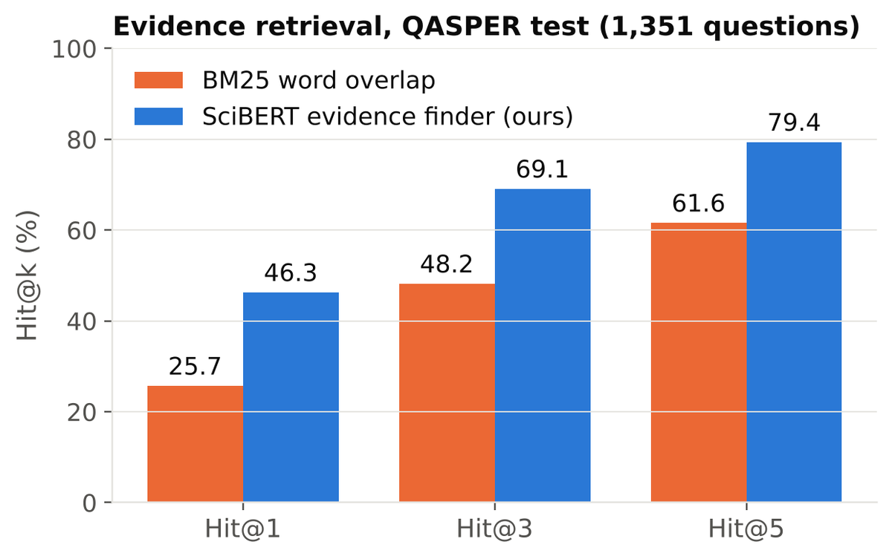
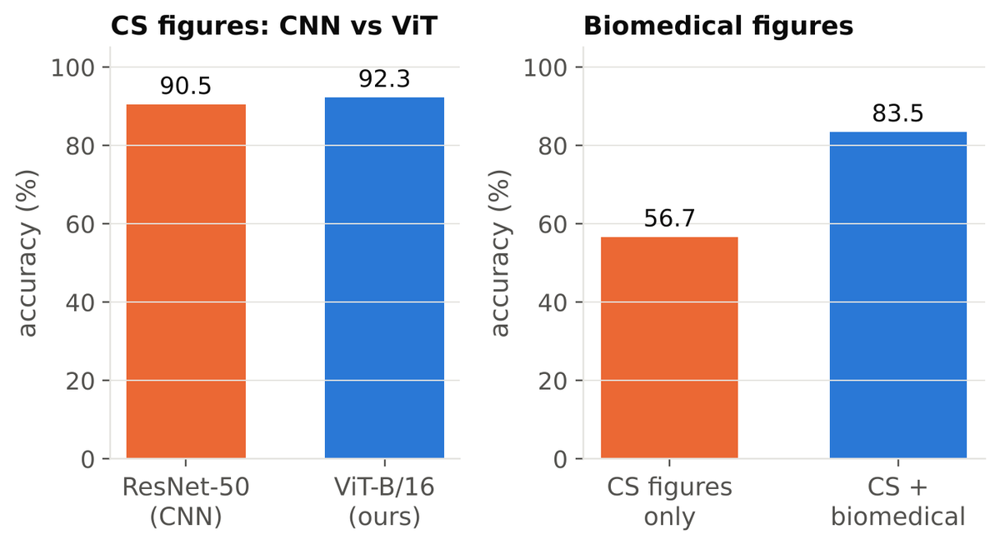
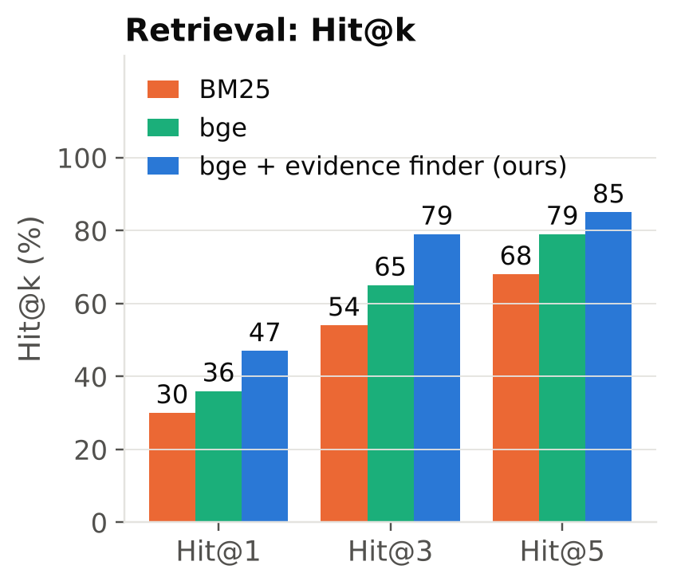
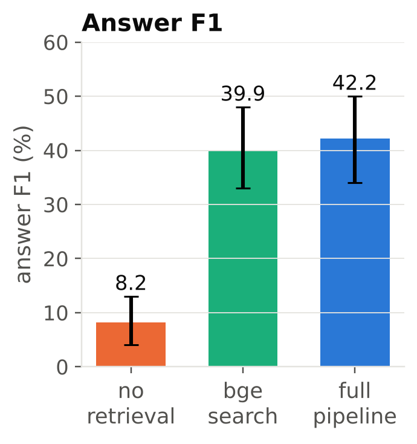
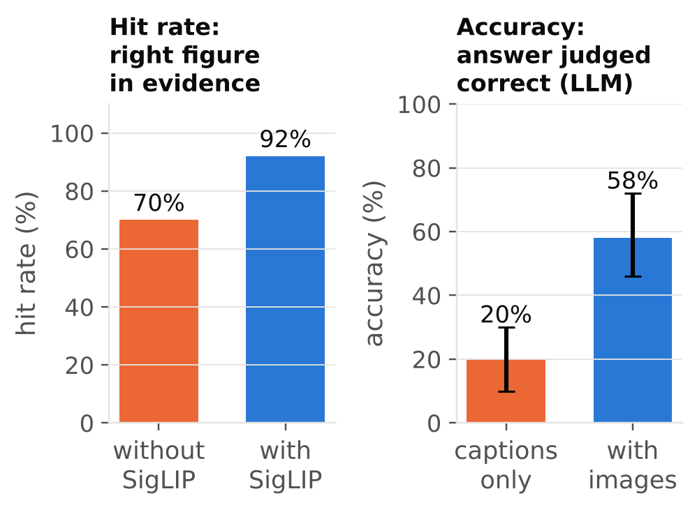

# Results

All numbers are on held-out test sets that were never used for training or early stopping. Each model was scored once,
with the checkpoint from its best validation epoch (seed 42). The full result files (`metrics.json`, `history.csv`,
`predictions.jsonl`, `config.json`) are stored in the `researchlens-results` dataset on Hugging Face, and
`notebooks/2_evaluation/R1_results_all_models.ipynb` rebuilds every graph and table from them without retraining.

## 1. Fine-tuned models

| Model | Test set | Metric | Result | Baseline |
|---|---|---|---|---|
| SciBERT NER (multi-domain, final) | SciERC (AI papers) | entity F1 | **61.0** | |
| SciBERT NER (SciERC only) | SciERC (AI papers) | entity F1, mean of 3 seeds | **64.4** | BERT-base 60.7 |
| SciBERT NER | other fields (ScienceIE) | entity F1 | **39.3** | AI-only training 19.5 |
| SciBERT relation extractor | SciERC | micro-F1 | **67.7** | |
| SciBERT evidence finder | QASPER, 1,351 questions | Hit@1 / Hit@3 / Hit@5 | **46.3 / 69.1 / 79.4** | BM25 25.7 / 48.2 / 61.6 |
| SciBERT evidence finder | QASPER, 1,351 questions | MRR | **60.5** | BM25 41.7 |
| SciBERT caption classifier | SPIQA captions | accuracy / macro-F1 | **80.3% / 68.1** | |
| ViT-B/16 figure classifier (CS + biomedical) | SPIQA, 1,115 CS figures | accuracy | **91.6%** | |
| ViT-B/16 figure classifier (CS + biomedical) | BIOMEDICA, 1,500 figures | accuracy | **83.5%** | CS-only training 56.7% |
| ViT-B/16 (CS only) | SPIQA | accuracy | **92.3%** | ResNet-50 90.5% |
| TrOCR formula reader | im2latex-100k, 2,000 formulas | BLEU-4 | **85.2** | |
| TrOCR formula reader | im2latex-100k | exact match / character error rate | **29.0% / 12.9%** | |
| Gated ViT + SciBERT fusion (experiment) | SPIQA | accuracy | 92.1% | simple averaging 93.6% (used in the app) |

  
  

## 2. Whole system (retrieval + Gemini)

Text questions: 100 QASPER questions from 55 papers. Figure questions: 50 SPIQA test questions. Intervals are 95%
bootstrap intervals.

| Setting | Hit@1 | Hit@3 | Hit@5 | MRR | Answer F1 | Citation precision |
|---|---|---|---|---|---|---|
| Gemini, no retrieval | | | | | 8.2 | |
| BM25 | 30 | 54 | 68 | 46.7 | | |
| bge-small search | 36 | 65 | 79 | 54.4 | 39.9 | 56.4% |
| **bge + SciBERT evidence finder (final)** | **47** | **79** | **85** | **63.7** | **42.2** | **66.1%** |

| Figure questions | Without | With |
|---|---|---|
| Right figure in the evidence (SigLIP image search) | 70% | **92%** |
| Answer judged correct by an LLM (Gemini sees the figure images) | 20% (captions only) | **58%** |

  
  
  

These are our own 100- and 50-question subsets with a newer Gemini model, so they are not directly comparable with
the numbers in the QASPER and SPIQA papers. Even with the right figure in the evidence, 19 of 46 figure questions were
still answered wrongly, so reading dense charts remains the main open problem.
